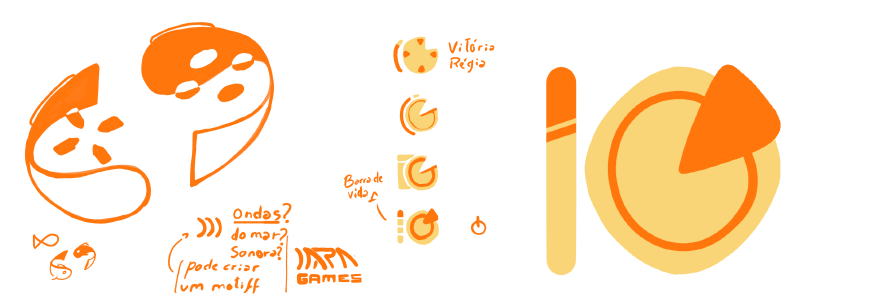

# 🎮 Iara Games

Plataforma brasileira de distribuição de jogos digitais, com foco em **jogos de estúdios brasileiros**. Projeto acadêmico em grupo, com identidade visual própria inspirada na lenda da Iara e na natureza brasileira.



## 🌐 Projeto publicado

https://iaragames.onrender.com/

Para testar a compra, use o cartão de teste da Stripe: `4242 4242 4242 4242`, com qualquer data futura, qualquer CVC e qualquer nome. **Nenhum valor real é cobrado.** Quem acessa o site não precisa criar conta na Stripe.

## 👥 Integrantes

* Leonardo Franco Arakaki
* Murilo de Melo Sousa
* Samuel Liasch Alves
* Walisson Souza dos Santos

## ✨ O que a plataforma tem

* **Página inicial** com carrossel de jogos em destaque, vitrines, ofertas e busca de jogos;
* **Catálogo** com todos os jogos e filtros por seção e por categoria (Ação, Aventura, RPG e Estratégia);
* **Página de cada jogo** com galeria de imagens e vídeo, requisitos de PC, jogos semelhantes e avaliações;
* **Compra com pagamento real em modo de teste**, pela Stripe;
* **Login, cadastro e preferências** em pop-up.

## 🛠️ Tecnologias

| Tecnologia | Uso |
| --- | --- |
| HTML5, CSS3 e JavaScript | Páginas, estilos e interatividade |
| React 18 | Catálogo, página do jogo e retorno do pagamento |
| Node.js e Express | Servidor que entrega o site e a API de pagamento |
| Stripe Checkout | Pagamento (modo de teste) |
| Render | Publicação do projeto |

## 💳 Como o pagamento funciona

1. Na página do jogo, o botão **Comprar** envia ao servidor apenas o id do jogo;
2. O servidor busca o preço no catálogo e cria a sessão de pagamento na Stripe;
3. A pessoa paga na página segura da Stripe e volta para a loja;
4. A loja consulta a Stripe e mostra se o pagamento foi aprovado.

A chave secreta da Stripe fica **só no servidor** (como variável de ambiente na Render ou em `server/.env`), nunca no navegador nem no GitHub.

## ▶️ Como rodar na sua máquina

Precisa do Node.js 18 ou superior.

```text
npm install
npm start
```

Abra **http://localhost:3000**. O site e a navegação funcionam assim mesmo.

O botão **Comprar** só funciona se o servidor tiver uma chave da Stripe em modo de teste. Para testar a compra localmente, copie `server/.env.example` para `server/.env` e preencha `STRIPE_SECRET_KEY` com uma chave `sk_test_...` (da conta de quem está rodando o projeto). Esse arquivo não vai para o GitHub.

## 🗂️ Estrutura

```text
index.html, catalogo.html     Páginas principais
games/                        Página do jogo, retorno do pagamento e imagens de cada jogo
formulario/                   Login, cadastro e preferências
javascript/                   Scripts do site e telas em React (catalogo/ e jogo/)
server/                       API de pagamento (Node.js e Express)
css/, imgs/, gifs/            Estilos e imagens
docs/                         Documentação detalhada das interações do projeto
```

## 📌 Status

Pagamento funcionando em modo de teste. As notas e as avaliações de usuários são fictícias, e login, carrinho e favoritos ainda são apenas visuais, sem salvar dados.

A documentação detalhada de cada interação do site está em [`docs/DOCUMENTACAO-DETALHADA.md`](docs/DOCUMENTACAO-DETALHADA.md).
